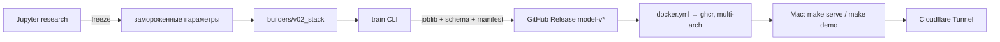

# houseprice-mlops

Конвейер для регрессии цен на жильё (Ames Housing) от исследования до продакшена:
Jupyter → установочный пакет → воспроизводимый поиск гиперпараметров →
версионированные артефакты → FastAPI → CI/CD → Docker → запуск на своём железе
одной командой.


## Метрики (v0.2.0 — стекинг из 10 базовых моделей + RidgeCV-мета)

| Оценка | RMSLE | Что это |
| --- | --- | --- |
| Кросс-валидация, 5-fold | **0.1157 ± 0.0242** | основная метрика: честная оценка обобщения на 1460 домах |
| Out-of-fold | 0.1182 | предсказания вне обучающего фолда, собранные по всем сплитам |
| Наивный бейзлайн (медиана по району) | 0.2698 | модель даёт lift +56% |
| Kaggle Public LB | 0.1169 | внешняя проверка: сабмит на тесте, RMSLE считает Kaggle |

Дополнительно на обучающей выборке: R² 0.957, MAE $10.6k, MedAE $7.2k, MAPE 6.1%,
P90 |ошибки| $22.8k.

**Почему нет строки «локальный holdout на тесте».** У House Prices (Getting
Started) таргет теста публичен, поэтому единственная честная внешняя оценка — та,
где ответы держит Kaggle, а не я. Локально таргета теста в репозитории нет;
`make submit` строит `submission.csv`, дальше его судит Public LB. Внутри проекта
за качество отвечает кросс-валидация.

CV RMSLE 0.1157 и Kaggle LB 0.1169 расходятся на 0.001 — CV честно предсказывает
внешнюю метрику, то есть пайплайн не переобучен под валидационный сплит.

## Архитектура



Поиск гиперпараметров вынесен в `research/` и заморожен в билдер: обучение
воспроизводит найденного победителя, а не ищет заново на каждом прогоне.

## Быстрый старт

```bash
uv sync
make train          # обучение: артефакты + манифест метрик
uv run pytest -q    # тесты, включая метрический гейт по CV RMSLE
make metrics        # отчёт по метрикам последней модели
make serve          # Docker: http://localhost:8001/docs
```

`make help` печатает все доступные команды.

## Оценка на Kaggle

```bash
# test.csv не в репозитории — путь задаётся явно
HOUSEPRICE_TEST=/путь/к/test.csv make submit
# → submission.csv (Id, SalePrice)
kaggle competitions submit \
  -c house-prices-advanced-regression-techniques \
  -f submission.csv -m "houseprice_model 0.2.0"
```

## API

```bash
curl -X POST localhost:8001/api/v1/predict -H 'Content-Type: application/json' \
  -d '{"inputs": [{"GrLivArea": 1710, "OverallQual": 7, "YearBuilt": 2003, "Neighborhood": "CollgCr"}]}'
# {"predictions": [103620.35], "model_version": "0.2.0"}
```

Все 80 полей опциональны — пайплайн сам заполняет пропуски. В примере передано
4 поля, поэтому оценка занижена: остальные признаки заполняются медианами и
«отсутствием». Это часть контракта, а не ошибка.

## Что делает проект устойчивым

- **Воспроизводимый поиск.** `research/ridge_search.py` с `error_score='raise'` —
  падает на невалидном фите, а не прячет ошибку. Победитель заморожен в билдере
  и в `research/*_best_params.json`.
- **Манифест в артефакте.** Каждый `metrics.json` несёт версии python/sklearn/
  pandas/numpy, git-commit и хэш датасета. API отказывается стартовать, если
  версии окружения разошлись с теми, на которых обучалась модель.
- **Метрический гейт в CI.** Релиз модели не публикуется, если CV RMSLE выше
  порога — регрессия качества не проходит в прод.
- **Версионированные метрики.** `metrics-<версия>.json` хранятся в git;
  `make compare` показывает дельту между двумя последними версиями.

## Live demo

API живёт на моём MacBook и поднимается по запросу: `make demo` открывает
временный публичный URL через Cloudflare Tunnel на время сессии. Напишите —
включу и пришлю ссылку.

## История версий

Изменения и мотивация решений — в [CHANGELOG.md](CHANGELOG.md). README прошлых
версий доступны через теги: `git show model-v0.1.2:README.md`.

## Дальше

- диффтесты предсказаний между версиями модели;
- калибровка доверительных интервалов к предсказанию цены.
