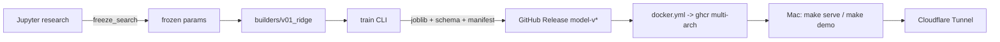

# houseprice-mlops

Прод-конвейер для модели цен на жильё (Ames Housing): исследование в Jupyter →
установочный пакет → воспроизводимый серч → версионированные артефакты →
FastAPI → CI/CD → Docker → запуск на своём железе одной командой.


## Метрики (v0.1.2, Ridge поверх по-колоночного ColumnTransformer)

| Срез | RMSLE | Комментарий |
|---|---|---|
| Internal holdout (28%) | 0.115 | детерминированный сплит, метрический гейт CI ≤ 0.121 |
| External (kaggle test, 1459 домов) | 0.127 | one-shot оценка против опубликованных ответов, без подбора |
| Наивный бейзлайн (медиана по району) | 0.275 | lift модели +58% |

Типичная ошибка: MedAE $9.2k / MAPE 8.3%; хвост: P90 $30.8k. CV 0.110±0.020.

## Архитектура



## Быстрый старт

```bash
uv sync
make train          # обучение, артефакты + манифест метрик
uv run pytest -q    # 42 тестов, включая метрический гейт
make serve          # Docker: http://localhost:8001/docs
```

## API

```bash
curl -X POST localhost:8001/api/v1/predict -H 'Content-Type: application/json' \
  -d '{"inputs": [{"GrLivArea": 1710, "OverallQual": 7, "YearBuilt": 2003, "Neighborhood": "CollgCr"}]}'
# {"predictions": [208500.0], "model_version": "0.1.2"}
```
Все 80 полей опциональны: пайплайн сам заполняет пропуски (проверено на сыром
kaggle-тесте, включая дома без подвала/гаража).

## Честность цифр

- Серч гиперпараметров воспроизводим скриптом (`research/ridge_search.py`,
  `error_score='raise'` — 300/300 валидных фитов); победитель заморожен в
  builder и в `research/ridge_best_params.json`.
- External-оценка получена однократно против опубликованных ответов Ames —
  без итераций по ним; она согласуется с internal-holdout с ожидаемым
  generalization gap (+0.012).
- Артефакт несёт манифест: версии python/sklearn/pandas/numpy, git-commit,
  хэш датасета — API отказывается стартовать при version-skew.

## Live demo

API хостится на моём MacBook и поднимается по запросу: `make demo`
(Cloudflare Tunnel, временный публичный URL на время сессии).
Напишите мне — включу и пришлю ссылку.

## Roadmap

- v0.2: стекинг (GB/RF/XGB/SVR/ENet + RidgeCV-мета) — базовые серчи готовы в research/
- диффтесты предсказаний между версиями модели
